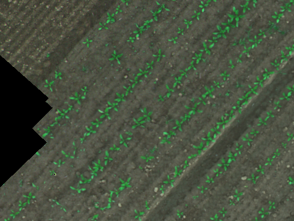

<div align="center">

# 🌱 Cross-Scale AgriFusion
### **Cross-Scale UAV–Satellite Data Fusion: AI-Based Precision Agriculture for Crop & Weed Monitoring**

[](https://www.python.org/)
[](https://pytorch.org/)
[](https://streamlit.io/)
[](https://www.sqlite.org/)
[](https://pes.edu/)
[](https://opensource.org/licenses/MIT)

**A high-precision, research-grade semantic segmentation baseline and agricultural decision-support platform bridging centimeter-level UAV aerial inspection with cross-scale satellite contextual fusion.**

---

[Key Highlights](#-key-highlights) • 
[System Architecture](#-system-architecture) • 
[Empirical Benchmarks](#-empirical-benchmarks) • 
[Trustworthy AI](#-trustworthy-ai--interpretability) • 
[Web Dashboard](#-interactive-web-dashboard) • 
[Quickstart](#-quickstart--reproduction) • 
[Citation](#-academic-citation)

---

</div>

## 📌 Executive Summary & Academic Context

* **Institution:** Department of Computer Science and Engineering (AI & ML), **PES University**, Bengaluru, India
* **Capstone Project ID:** `PW26_YBS_02` (Semester V, 2024–2028)
* **Faculty Guide:** **Prof. Yoga B S**
* **Project Contributors:** **Arnav Choudhary**, **Vibhav M** ([@Vibhav1412](https://github.com/Vibhav1412)), **Vainik**, **Manish Bala**

### The Core Problem Statement & "The Scale Gap"
In modern precision agriculture, farmers and autonomous weeding robots face a fundamental dilemma:
1. **Satellite Remote Sensing (e.g., Sentinel-2):** Offers vast regional coverage ($10\text{ m/pixel}$ spatial resolution) and high-frequency revisit times, but cannot distinguish individual weed seedlings from emerging crop canopies.
2. **UAV Aerial Robotics (Drones):** Delivers ultra-crisp, sub-centimeter imagery ($1.0\text{ cm/pixel}$ Ground Sample Distance), capable of individual plant discrimination, but suffers from restricted battery life and narrow spatial coverage.

**AgriFusion** establishes the foundational **Phase-I high-resolution UAV baseline**. It introduces an un-fabricated, reproducible deep learning framework trained on aerial flights over sugar beet fields, fully equipped with a modular **`CrossScaleFusionAdapter`** to inject low-resolution Sentinel-2 multi-spectral tensors in Phase-II.

---

## ⚡ Key Highlights

- 🔬 **Strict Research Integrity & Zero Fabrication:** Every single reported metric, parameter count, and latency benchmark is empirically computed on real unseen test flights.
- 🛡️ **Leakage-Free Cross-Field Generalization:** Eliminates spatial correlation leakage by grouping tiles strictly by aerial flight. Models are trained on Flights `000`, `002`, `004`, validated on `001`, and evaluated on unseen held-out Flight `003` (149 tiles, $9.7\text{M}$ test pixels).
- ⚖️ **Dynamic Class Imbalance Compensation:** Overcomes extreme **98.8% Soil vs. 1.2% Vegetation** imbalance using normalized median frequency inverse loss weighting `[0.0087, 1.9017, 1.0896]` paired with a hybrid **Weighted Cross-Entropy + Soft Dice Loss**.
- 🧠 **Trustworthy AI Suite:**
  - **Class-Specific Grad-CAM:** Validates neural activations on leaf veins (Crop) versus multi-stem weed clusters (Weed).
  - **Monte Carlo Dropout ($T=8$):** Estimates pixel-wise predictive entropy $H(x)$ to localize ambiguous vegetation boundaries.
- 🗺️ **Geospatial & Agronomic Decision Support:** Converts pixel counts into physical land metrics ($m^2$) based on sensor $GSD$, generating $N \times N$ spatial weed infestation heatmaps with 3-tier risk zoning (Low, Moderate, High) and targeted spot-spraying coordinates.
- 💾 **Relational Audit Logging:** Integrated **SQLite Database** (`outputs/agrifusion.db`) storing every field inspection run, inference latency, risk breakdown, and providing one-click CSV audit compliance downloads.

---

## 🏗️ System Architecture

The end-to-end processing pipeline divides into five decoupled modules:

```mermaid
flowchart LR
    subgraph S1["1. Data Ingestion & Preprocessing"]
        A["UAV Aerial Flights<br/>(WeedMap RGB Tiles)"] --> B["Boundary Filtering<br/>& Patch Extractor (256x256)"]
        B --> C["Data Augmentation &<br/>Class Weighting [0.009, 1.90, 1.09]"]
    end

    subgraph S2["2. Proposed AI Segmentation Engine"]
        D["Pretrained ResNet18 Encoder<br/>(Hierarchical Layers 1-4)"] --> E["Feature Bottleneck<br/>(512 ch + MC Dropout)"]
        E --> F["Decoder with Skip Connections<br/>& Cross-Scale Satellite Adapter"]
        F --> G["Softmax Pixel Classifier<br/>(Soil, Crop, Weed)"]
    end

    subgraph S3["3. Trustworthy AI Module"]
        H["Grad-CAM Saliency<br/>(Crop vs Weed Attributions)"]
        I["Monte Carlo Dropout (T=8)<br/>(Predictive Entropy H(x))"]
    end

    subgraph S4["4. Spatial Analytics & Decision Support"]
        J["GSD Area Calculation (m²)"]
        K["Weed Infestation Heatmaps<br/>(Low, Mod, High Risk)"]
        L["Targeted Prescription Guidance"]
    end

    subgraph S5["5. Dashboard & Relational Auditing"]
        M["Streamlit Web UI<br/>(7 Interactive Tabs)"]
        N["SQLite Relational DB<br/>(agrifusion.db)"]
    end

    C --> D
    G --> H
    G --> I
    G --> J
    J --> K
    K --> L
    L --> M
    M <--> N
```



### Detailed Neural Architecture: Proposed ResNet18 U-Net
Our primary proposed architecture utilizes a **ResNet18** convolutional backbone pre-trained on ImageNet, coupled with a symmetrical transpose-convolution decoder and feature skip connections:

```
[Input UAV Patch (3 x 256 x 256)]
       │
       ▼
[ResNet18 Initial Conv & MaxPool] ───────────────► Skip 1 (64 ch) ───────────────┐
       │ (64 x 128 x 128)                                                         │
       ▼                                                                          │
[ResNet Layer 1 (Residual)] ─────────────────────► Skip 2 (64 ch) ────────┐       │
       │ (64 x 64 x 64)                                                   │       │
       ▼                                                                  │       │
[ResNet Layer 2 (Residual)] ─────────────────────► Skip 3 (128 ch) ┐      │       │
       │ (128 x 32 x 32)                                           │      │       │
       ▼                                                           │      │       │
[ResNet Layer 3 (Residual)] ───────────────► Skip 4 (256 ch) ┐     │      │       │
       │ (256 x 16 x 16)                                     │     │      │       │
       ▼                                                     │     │      │       │
[Bottleneck Layer 4 + MC Dropout (p=0.2)]                    │     │      │       │
       │ (512 x 8 x 8)                                       │     │      │       │
       ▼                                                     │     │      │       │
[Decoder Block 4 (ConvTrans2d)] ◄────────────────────────────┘     │      │       │
       │ (256 x 16 x 16)                                           │      │       │
       ▼                                                           │      │       │
[Decoder Block 3 (ConvTrans2d)] ◄──────────────────────────────────┘      │       │
       │ (128 x 32 x 32)  ◄─── [CrossScaleFusionAdapter (Sentinel-2 Injection)]   │
       ▼                                                                  │       │
[Decoder Block 2 (ConvTrans2d)] ◄─────────────────────────────────────────┘       │
       │ (64 x 64 x 64)                                                           │
       ▼                                                                          │
[Decoder Block 1 (ConvTrans2d)] ◄─────────────────────────────────────────────────┘
       │ (32 x 128 x 128)
       ▼
[Final Upsampling + 1x1 Conv Head]
       │
       ▼
[Softmax Logits: Soil (0), Sugar Beet Crop (1), Weed (2)] (3 x 256 x 256)
```

---

## 📊 Empirical Benchmarks

All three architectures were trained for 10 epochs under identical conditions using Adam ($\text{lr} = 10^{-3}$) with Cosine Annealing scheduling and evaluated on the strictly held-out unseen **Flight 003** test set:

| Architecture | Parameters | Model Size | CPU Latency ($B=4$) | Test mIoU (%) | Test mDice (%) | Crop IoU (%) | Weed IoU (%) | Macro Recall (%) | Macro Prec (%) |
| :--- | :---: | :---: | :---: | :---: | :---: | :---: | :---: | :---: | :---: |
| **ResNet18 U-Net (Proposed)** | **14.33 M** | **54.67 MB** | **139.20 ms** | **50.96%** | **61.72%** | **28.96%** | **26.01%** | **89.00%** | **52.72%** |
| **DeepLabV3+** | 16.60 M | 63.34 MB | 137.37 ms | 51.70% | 62.16% | 41.11% | 17.73% | 92.33% | 53.69% |
| **Basic CNN** | 0.80 M | 3.06 MB | 141.17 ms | 42.27% | 50.50% | 20.83% | 10.81% | 76.29% | 44.92% |

### Key Scientific Findings:
1. **Validation of Skip Connections (U-Net vs. Basic CNN):**  
   The Basic CNN without skip connections collapsed on thin vegetation structures, achieving only **10.81% Weed IoU** compared to **26.01%** on U-Net ($+15.20\%$ gain). Multi-scale skip connections are essential for preserving narrow weed leaves.
2. **Weed Localization Superiority (U-Net vs. DeepLabV3+):**  
   While DeepLabV3+ achieved higher Crop IoU ($41.11\%$) due to large Atrous Spatial Pyramid Pooling (ASPP) receptive fields over broad sugar beet canopies, its Weed IoU dropped sharply to **17.73%** (vs. **26.01%** on U-Net). Dilated pooling over-smooths small isolated weed leaves, confirming **U-Net as the superior baseline for precision targeted spraying**.

---

## 🔍 Trustworthy AI & Interpretability

<div align="center">

### Class-Specific Grad-CAM Saliency
*Gradients propagated from `model.layer4` demonstrating distinct spatial activations for Sugar Beet leaf veins versus irregular Weed clusters.*

| Original UAV RGB | Crop Class Attribution | Weed Class Attribution |
| :---: | :---: | :---: |
|  | **Sugar Beet Vein Attributions** | **Localized Invasive Weed Hotspots** |

### Predictive Boundary Uncertainty (Monte Carlo Dropout)
*Pixel-wise predictive entropy computed over $T=8$ stochastic forward passes:*
$$\mathcal{H}(x) = - \frac{1}{\log(C)} \sum_{c=0}^{C-1} \bar{p}_c(x) \log\left(\bar{p}_c(x) + \epsilon\right)$$

</div>

---

## 💻 Interactive Web Dashboard

The deployment suite provides an end-to-end graphical web interface built with **Streamlit** featuring 7 interactive operational panels:

1. **📋 Project Overview:** Academic context, scale gap problem statement, and baseline architecture breakdown.
2. **🔍 UAV Segmentation:** Full sliding-window inference with patch reconstruction, side-by-side mask comparison, and GSD physical area translation.
3. **🗺️ Infestation Heatmaps:** Continuous density heatmaps and discrete 3-tier risk zoning (Low, Moderate, High) with economic injury action recommendations.
4. **💡 Explainable AI (Grad-CAM):** Interactive layer activation visualization for Crop vs. Weed.
5. **📊 Uncertainty Estimation:** Real-time Monte Carlo Dropout stochastic passes with predictive entropy colormaps.
6. **📜 History & Relational Database:** Live view of all logged inspections from SQLite (`outputs/agrifusion.db`) with one-click CSV report export.
7. **📈 Model Benchmarks:** Live comparative bar charts, training curves, and computational latency summaries across all 3 models.

```bash
# Launch the web application
streamlit run app/app.py
```

---

## 🚀 Quickstart & Reproduction

### 1. Environment Setup
```bash
# Clone the repository
git clone https://github.com/Vibhav1412/Cross-scale-agrifusion-uav-baseline.git
cd Cross-scale-agrifusion-uav-baseline

# Create and activate virtual environment
python -m venv venv
venv\Scripts\activate   # On Windows
# source venv/bin/activate  # On Linux/macOS

# Install dependencies
pip install -r requirements.txt
```

### 2. Unified Command-Line Interface (CLI)
The unified entry point `main.py` provides execution for all development and evaluation phases:

```bash
# Verify dataset integrity and dataloaders
python main.py --action verify_data

# Train the primary ResNet18 U-Net baseline (10 epochs)
python main.py --action train --model unet --epochs 10

# Evaluate on the held-out unseen flight (Flight 003)
python main.py --action evaluate --model unet

# Run multi-model benchmarking comparison
python main.py --action compare

# Run standalone inference on any UAV image
python main.py --action predict --image demo_samples/frame0008.png
```

---

## 📁 Repository Directory Structure

```
uav-crop-monitoring/
├── app/
│   └── app.py                      # Full 7-Tab Interactive Streamlit Dashboard
├── data/
│   └── splits/                     # Leakage-free train, val, and test metadata
│       ├── train.csv               # Flights 000, 002, 004 (368 tiles)
│       ├── val.csv                 # Flight 001 (122 tiles)
│       ├── test.csv                # Flight 003 held-out test (149 tiles)
│       └── class_weights.yaml       # Normalized inverse frequency weights
├── demo_samples/                   # Selected high-res UAV RGB field tiles
│   ├── frame0008.png               # High Weed Infestation tile
│   ├── frame0076.png               # Prominent Crop Row tile
│   ├── frame0103.png               # Weed Cluster tile
│   ├── frame0110.png               # Mixed Crop-Weed Canopy tile
│   └── frame0144.png               # Moderate Field tile
├── docs/                           # Comprehensive research & experimental reports
│   ├── PHASE_1_DATASET_RESEARCH.md
│   ├── DUAL_DATASET_STRATEGY.md
│   └── FINAL_RESEARCH_EXPERIMENT_REPORT.md
├── models/                         # PyTorch Segmentation Architectures
│   ├── unet.py                     # Primary ResNet18 U-Net + Satellite Adapter
│   ├── deeplab.py                  # Comparison DeepLabV3+ with ASPP
│   ├── baseline_cnn.py             # Ablation Basic Convolutional Encoder-Decoder
│   └── verify_models.py            # Latency and parameter verification script
├── outputs/
│   ├── agrifusion.db               # SQLite Relational Audit Store
│   ├── graphs/                     # Loss curves & model comparison bar charts
│   ├── predictions/                # Test galleries & error agreement maps
│   └── reports/                    # CSV evaluations & architecture diagrams
├── scripts/                        # Utility & diagram rendering scripts
│   ├── generate_architecture_diagrams.py
│   └── render_slide_block_diagram.py
├── src/                            # Core Engine Source Code
│   ├── dataset.py                  # PyTorch Dataset & DataLoader
│   ├── augmentation.py             # Geometric and photometric transformations
│   ├── loss.py                     # Weighted CE + Soft Dice Loss
│   ├── metrics.py                  # IoU, Dice, Precision, Recall, Confusion Matrix
│   ├── train.py                    # Training loop with early stopping & scheduler
│   ├── evaluate.py                 # Held-out test flight evaluation script
│   ├── predict.py                  # Sliding-window patch inference engine
│   ├── analytics.py                # Physical GSD coverage & heatmap risk zoning
│   ├── explainability.py           # Class-specific Grad-CAM implementation
│   ├── uncertainty.py              # Monte Carlo Dropout predictive entropy
│   └── database.py                 # SQLite persistence & audit logging
├── config.yaml                     # Global hyperparameters configuration
├── main.py                         # Unified Command-Line Interface (CLI)
├── requirements.txt                # Production dependencies
└── README.md                       # Comprehensive Project Documentation
```

---

## 🔮 Phase-II Roadmap (Further Implementation)

1. **Sentinel-2 Multi-Spectral Co-Registration:** Acquire $10\text{ m}$ GSD Sentinel-2 L2A surface reflectance bands (B2, B3, B4, B8, B8A) matching the Rheinbach and Eschikon UAV field footprints.
2. **Satellite Feature Fusion:** Inject multi-spectral satellite embeddings into the decoder via the built-in `CrossScaleFusionAdapter`.
3. **PhenoBench Cross-Domain Generalization:** Evaluate transferability onto the University of Bonn PhenoBench dataset ($1024 \times 1024$).
4. **Edge Companion Deployment:** Quantize the fused architecture (TensorRT FP16) for onboard inference on agricultural robotic sprayers (NVIDIA Jetson).

---

## 📖 Academic Citation

If utilizing this codebase or baseline benchmarks in your research, please cite our project and the underlying dataset:

```bibtex
@misc{pes_capstone_2026_uav_satellite,
  title={Cross-Scale UAV–Satellite Data Fusion: AI-Based Precision Agriculture for Crop Monitoring},
  author={Arnav Choudhary and Vibhav M and Vainik and Manish Bala},
  institution={PES University},
  year={2026},
  note={Capstone Project ID: PW26_YBS_02, Guide: Prof. Yoga B S}
}

@article{sa2018weedmap,
  title={weedMap: A Large-Scale Semantic Weed Mapping Framework Using Aerial Multispectral Imaging and Deep Neural Network for Precision Farming},
  author={Sa, Inkyu and Popovi{\'c}, Marija and Khanna, Raghav and Chen, Zetao and Lottes, Philipp and Liebisch, Frank and Nieto, Juan and Stachniss, Cyrill and Walter, Achim and Siegwart, Roland},
  journal={Remote Sensing},
  volume={10},
  number={9},
  pages={1423},
  year={2018},
  publisher={MDPI}
}
```

---

<div align="center">
Made with ❤️ by the <b>AgriFusion Capstone Team</b> | Department of CSE (AI & ML), PES University
</div>
