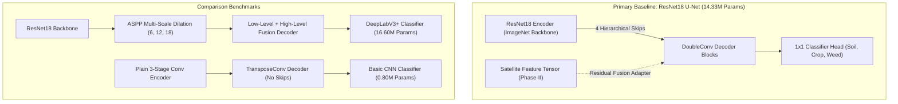

# Capstone Project: Cross-Scale UAV–Satellite Data Fusion
## Phase 3: Model Architectures & Benchmark Verification

**Project ID:** PW26_YBS_02 | **Institution:** PES University | **Department:** B.Tech CSE (AI & ML)  
**Hardware Profile:** Apple Silicon / CPU / CUDA Compatible  

---

## 1. Architectural Design Overview

In accordance with Phase 3 specifications, we designed and implemented three modular semantic segmentation architectures in PyTorch:

---

## 2. Empirical Model Verification & Benchmark Table

Evaluated on PyTorch with standard input resolution $(B=4, C=3, H=256, W=256)$:

| Architecture | Model File | Parameters | Memory Size | CPU Latency ($B=4$) | Per-Image Latency | Key Design Feature |
| :--- | :--- | :---: | :---: | :---: | :---: | :--- |
| **U-Net (ResNet18)** *(Primary Proposed)* | [`models/unet.py`](models/unet.py) | **14.33 M** | **54.67 MB** | **139.20 ms** | **34.80 ms** | Pretrained encoder, 4 skip connections, modular cross-scale satellite fusion adapter |
| **DeepLabV3+ (ResNet18)** | [`models/deeplab.py`](models/deeplab.py) | **16.60 M** | **63.34 MB** | **137.37 ms** | **34.34 ms** | Atrous Spatial Pyramid Pooling (ASPP) for multi-scale receptive field |
| **Basic CNN Segmenter** | [`models/baseline_cnn.py`](models/baseline_cnn.py) | **0.80 M** | **3.06 MB** | **141.17 ms** | **35.29 ms** | Lightweight vanilla encoder-decoder without skip connections |

- Architectural verification results saved to: [`outputs/reports/model_architectures_summary.csv`](outputs/reports/model_architectures_summary.csv).

---

## 3. Special Research Features Built-In

1. **Phase-II Cross-Scale Satellite Fusion Hook (`CrossScaleFusionAdapter`):**
   - The U-Net decoder includes a dedicated residual modulation adapter that projects incoming satellite feature maps into the decoder feature space without channel mismatch.
2. **Monte Carlo Dropout (`enable_mc_dropout()`):**
   - Supports test-time stochastic dropout inference across spatial feature maps to compute pixel-wise predictive entropy (Feature 6: Uncertainty Estimation).

